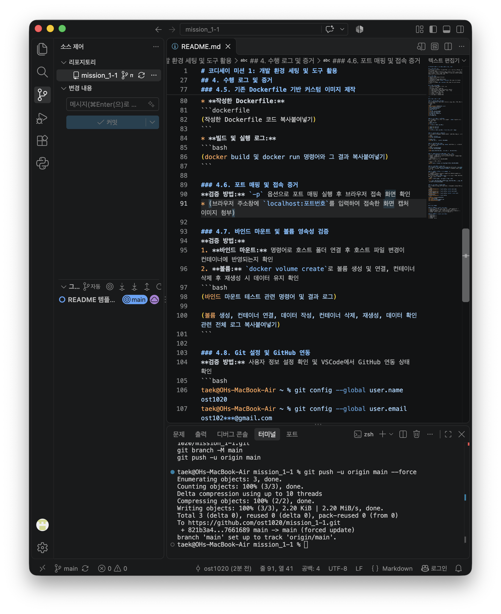

# 코디세이 미션 1: 개발 환경 세팅 및 도구 활용

## 1. 프로젝트 개요
* **목표:** 개발을 위한 워크스테이션 구축 및 핵심 도구(터미널, Docker, Git) 활용법 습득
* **요약:** 리눅스 CLI(터미널) 조작, Docker를 이용한 격리된 컨테이너 실행 및 커스텀 이미지 제작, 포트 매핑과 볼륨을 통한 데이터 영속성 검증, 협업을 위한 Git/GitHub 환경 세팅

## 2. 실행 환경
* **OS:** macOS (Apple Silicon)
* **Shell:** zsh (`/bin/zsh`)
* **Terminal:** vscode
* **Docker:** Docker version 29.9.2, build a82e528
* **Git:** git version 2.56.0

## 3. 수행 체크리스트
- [x] 터미널 기본 조작 및 폴더 구성
- [x] 권한 변경 실습
- [x] Docker 설치 및 기본 점검
- [ ] 컨테이너 실행 실습 (hello-world, ubuntu)
- [ ] 기존 Dockerfile 기반 커스텀 이미지 제작
- [ ] 포트 매핑 및 접속 증거
- [ ] 바인드 마운트 반영 증거
- [ ] Docker 볼륨 영속성 검증
- [ ] Git 설정 및 GitHub 연동

---

## 4. 수행 로그 및 증거

### 4.1. 터미널 조작 로그 기록
**검증 방법:** 현재 위치 확인, 폴더/파일 생성, 복사, 이동, 삭제 명령을 수행하여 확인
```bash
# 1. 위치 확인 및 폴더 생성/진입
taek@OHs-MacBook-Air mission_1-1 % pwd
/Users/taek/mission_1-1
# pwd (Print Working Directory): 현재 내가 위치한 폴더의 전체 경로를 알려줌. 터미널 안에서 "나 지금 컴퓨터 안에서 정확히 어디쯤 있지?" 하고 길을 잃었을 때 치는 나침반 같은 명령어.
taek@OHs-MacBook-Air mission_1-1 % mkdir codyssey-practice
# mkdir (Make Directory): 새 폴더를 만드는 명령어. mkdir codyssey-practice로 실습 전용 방을 하나 새로 팜.
taek@OHs-MacBook-Air mission_1-1 % cd codyssey-practice
# cd (Change Directory): 다른 폴더로 이동할 때 씀. 방금 만든 codyssey-practice 방 안으로 쏙 들어감. (cd ..이라고 치면 다시 바깥 폴더로 빠져나올 수 있음.)

# 2. 빈 파일 생성 및 권한/상세 리스트 확인
taek@OHs-MacBook-Air codyssey-practice % touch text.txt
# touch: 내용이 텅 빈 새 파일을 뚝딱 만들어주는 명령어. touch text.txt를 쳐서 텍스트 파일을 하나 생성함.
taek@OHs-MacBook-Air codyssey-practice % ls -la
# ls -la (List): 현재 폴더 안에 뭐가 있는지 목록을 쫙 보여줌. -l 옵션은 권한, 용량, 만든 날짜 같은 상세 정보를 보겠다는 뜻, -a 옵션은 이름 앞에 점(.)이 붙은 숨겨진 파일까지 남김없이 다 보여달라는 뜻.

# 3. 파일 복사, 이동(이름 변경), 내용 출력, 삭제 실습
taek@OHs-MacBook-Air codyssey-practice % cp text.txt copy.txt
# cp (Copy): 파일 복사하기. cp text.txt copy.txt는 원본 파일(text.txt)을 복사해서 copy.txt라는 똑같은 파일을 하나 더 만듦.
taek@OHs-MacBook-Air codyssey-practice % mv copy.txt rename.txt
# mv (Move): 파일의 위치를 옮기거나, 이름을 바꿀 때 씀. 지금은 mv copy.txt rename.txt라고 쳐서 파일 이름을 rename.txt로 쓱 바꿔치기함.
taek@OHs-MacBook-Air codyssey-practice % cat text.txt
# cat (Concatenate): 파일 안에 적힌 내용을 터미널 화면에 텍스트로 그대로 출력해서 보여줌. 지금은 빈 파일이었기 때문에 아무 글자도 안 나오고 끝남.
taek@OHs-MacBook-Air codyssey-practice % rm rename.txt
# rm (Remove): 파일을 삭제하는 명령어. 윈도우나 맥의 휴지통으로 가는 게 아니라 그 자리에서 즉시 영구 삭제되니까 실전에서는 꽤 조심해서 써야 함. rm rename.txt로 필요 없어진 파일을 깔끔하게 날려버림.
```
#### **추가 학습 및 Q&A**

❓ 나의 질문: 실습 중 mv copy.txt rename.txt 명령어를 통해 파일의 '이름'을 바꿨는데, 파일의 '위치'를 다른 폴더로 옮길 때는 mv를 어떻게 사용해야 하는지 궁금함.
💡 AI의 답변:
파일을 다른 폴더로 옮길 때는 mv [옮길 파일명] [목적지 폴더 경로] 순서로 입력하면 된다. mv 명령어 하나로 파일의 경로(위치)와 이름을 모두 제어할 수 있다. 자주 쓰이는 3가지 활용법은 다음과 같다.
하위 폴더(새 방)로 이동: mv text.txt backup/
상위 폴더(바깥 방)로 끄집어낼 때: mv text.txt .. (..은 상위 디렉토리를 의미함)
위치를 옮기며 이름도 동시에 바꿀 때: mv text.txt backup/new.txt

❓ 나의 질문: 문서 작성 중 코드블록 안팎에서 # 기호를 쓸 때, 이게 실행에 관여하지 않는 '주석(죽은 줄)'으로 쓰이는지 아니면 단순히 글자를 강조(제목)하는 용도로 쓰이는지 헷갈림.
💡 AI의 답변:
'#' 기호는 쓰이는 위치(코드블록 안과 밖)에 따라 역할이 완전히 달라진다.
코드블록(예: bash ... ) 안에서: 마크다운 문법이 아닌 해당 언어(bash)의 규칙을 따른다. 따라서 컴퓨터가 실행하지 않고 건너뛰는 '주석(Comment, 죽은 줄)' 역할을 하므로 안전하게 부연 설명을 적을 수 있다.
코드블록 밖(일반 마크다운)에서: 줄 맨 앞에 쓰면 글자를 크고 진하게 만들어주는 '제목(Header, 강조)' 역할을 한다. (예: ### 4.1.)

### 4.2. 권한 실습 및 증거 기록
**검증 방법:** 파일과 디렉토리를 생성하고 `chmod` 명령어로 권한 변경 전과 후를 비교

```bash
taek@OHs-MacBook-Air codyssey-practice % cd ~/mission_1-1/codyssey-practice
# cd (Change Directory): 폴더를 이동하라는 명령어. 
# ~ (물결표, Tilde): 내 맥북 기준 '홈 디렉토리(Home Directory)'를 의미하는 특별한 기호. 맥북 기준으로는 /Users/taek이라는 절대 경로와 완전히 똑같음. 내가 컴퓨터 어디에 숨어 있든 ~ 하나만 치면 바로 개인 폴더(집)로 순간이동할 수 있음.
# / (슬래시): 폴더와 폴더 사이를 구분하는 '경로 구분자'. (윈도우의 \와 같은 역할.)
# 해석: "내 홈 폴더(~) 안에 있는(/) mission_1-1 폴더 안에 있는(/) codyssey-practice 폴더로 이동해라."
taek@OHs-MacBook-Air codyssey-practice % touch perm_test.txt
# touch: 원래는 파일의 수정 시간을 현재 시간으로 톡 건드려(touch) 업데이트하는 명령어인데, '내용이 없는 빈 파일'을 뚝딱 만들 때 가장 많이 씀.
# 해석: "아무 내용이 없는 빈 텍스트 파일(perm_test.txt)을 생성해라."
taek@OHs-MacBook-Air codyssey-practice % ls -l
total 0
-rw-r--r--@ 1 taek  staff  0 Nov  3 15:35 perm_test.txt
-rw-r--r--@ 1 taek  staff  0 Nov  3 15:05 text.txt
# ls (List): 현재 폴더 안의 파일 목록을 보여줌.
# -l (Long format): 단순한 이름이 아니라 파일의 권한(자물쇠 상태), 소유자, 용량, 만든 날짜 등 '상세 정보'를 길게(long) 보여달라는 옵션.
# 1번째 칸 (-): 파일 종류. 이게 일반 파일인지 폴더인지 알려줌. -면 일반 파일, d면 디렉토리(폴더)라는 뜻이야.
# 2~4번째 칸 (rw-): 소유자(나, User)의 권한. 이 파일을 만든 '나'는 무엇을 할 수 있나? r(Read, 읽기)과 w(Write, 쓰기)는 가능하고, 세 번째 자리가 비어있으니(-) 프로그램처럼 실행(eXecute)은 못 한다는 뜻.
# 5~7번째 칸 (r--): 그룹(Group)의 권한. 나와 같은 그룹에 속한 사람들은 무엇을 할 수 있나? r(읽기)만 가능함.
# 8~10번째 칸 (r--): 기타 사용자(Others)의 권한. 나머지 모든 사람들은 무엇을 할 수 있나? 역시 r(읽기)만 가능함.
# 결론적으로 -rw-r--r--는 "나(소유자)는 읽고 수정할 수 있지만, 남들은 구경(읽기)만 할 수 있는 평범한 텍스트 파일"이라는 뜻.
taek@OHs-MacBook-Air codyssey-practice % chmod 700 perm_test.txt
# chmod (Change Mode): 파일이나 폴더의 권한을 변경하는 명령어.
# 700 (숫자 권한 방식): 세 자리 숫자는 각각 소유자(나) / 그룹 / 기타 사용자의 권한을 뜻함.
# 첫 번째 7 (소유자): 읽기(4) + 쓰기(2) + 실행(1)의 값을 더한 수. 즉, 모든 권한(4+2+1=7)을 나에게 줌.
# 두 번째 0 (그룹): 아무 권한 없음.
# 세 번째 0 (기타): 아무 권한 없음.
# 해석: "이 파일은 나만 읽고 쓰고 실행할 수 있고, 남들은 절대 건드리지 못하게 강력한 자물쇠를 채워라."
taek@OHs-MacBook-Air codyssey-practice % ls -l
total 0
-rwx------@ 1 taek  staff  0 Nov  3 15:35 perm_test.txt
-rw-r--r--@ 1 taek  staff  0 Nov  3 15:05 text.txt
# perm_test.txt 파일의 권한이 '-rw-r--r--'에서 '-rwx------'로 변경됨.
taek@OHs-MacBook-Air codyssey-practice % echo "echo 'Hello Permission'" > run.sh
# echo: 뒤에 오는 문장을 화면에 메아리(echo) 치듯 그대로 출력하라는 뜻.
# > (리다이렉션 기호): 출력의 방향을 화면이 아니라 '파일'로 돌려버리는 기호임.
# 해석: "화면에 echo 'Hello Permission'이라는 글자를 띄우지 말고, 그 글자를 그대로 run.sh라는 파일 안에 덮어써서(저장해서) 만들어라." (한 줄의 명령어로 간단한 스크립트 파일을 만든 거임)
taek@OHs-MacBook-Air codyssey-practice % ls -l
total 8
-rwx------@ 1 taek  staff   0 Nov  3 15:35 perm_test.txt
-rw-r--r--@ 1 taek  staff  24 Nov  3 15:37 run.sh
-rw-r--r--@ 1 taek  staff   0 Nov  3 15:05 text.txt
# run.sh 파일이 새로 생성됐고, run.sh에 echo 내용을 덮어쓰면서 바이트 블록의 크기가 변함.
taek@OHs-MacBook-Air codyssey-practice % chmod +x run.sh
# +x (기호 권한 방식): 숫자가 아닌 직관적인 기호로 권한을 주는 방식. +는 추가하겠다, x는 실행(eXecute) 권한을 의미함.
# 해석: "아까 만든 run.sh는 그냥 텍스트 파일(메모장)에 불과했는데, 이제 컴퓨터가 이걸 '프로그램'으로 인식해서 실행할 수 있도록 실행 권한(+x)을 달아줘라."
taek@OHs-MacBook-Air codyssey-practice % ls -l
total 8
-rwx------@ 1 taek  staff   0 Nov  3 15:35 perm_test.txt
-rwxr-xr-x@ 1 taek  staff  24 Nov  3 15:37 run.sh
-rw-r--r--@ 1 taek  staff   0 Nov  3 15:05 text.txt
taek@OHs-MacBook-Air codyssey-practice % ./run.sh
Hello Permission
# . (점): 리눅스에서 점 하나는 '현재 내가 있는 폴더(현재 위치)'를 뜻함.
# / (슬래시): 폴더 구분자.
# 해석: "현재 폴더(.) 안에 있는(/) run.sh를 실행해라."
# 왜 굳이 ./를 붙일까?: 리눅스/맥은 보안이 철저해서, 현재 폴더에 있는 프로그램이라도 이름만 치면(예: run.sh) 해킹 파일일지 모르니 튕겨내 버림. 그래서 반드시 "지금 내 위치에 있는 이 파일!"이라고 정확한 경로(./)를 콕 집어서 허락해 줘야만 실행됨.
```

#### 권한 변경 전후 비교
perm_test.txt 권한 축소 (숫자 방식):
변경 전 (ls -l): -rw-r--r-- (소유자는 읽기/쓰기 가능, 그룹 및 기타 사용자는 읽기 가능)
변경 후 (chmod 700): -rwx------ (소유자에게만 읽기/쓰기/실행 모든 권한을 부여하고, 나머지 사용자는 아예 접근하지 못하도록 자물쇠를 채움)
run.sh 실행 권한 부여 (기호 방식):
변경 전 (ls -l): -rw-r--r-- (일반 텍스트 문서 상태라 프로그램으로서 실행 불가)
변경 후 (chmod +x): -rwxr-xr-x (실행 권한을 뜻하는 x가 추가되어 ./run.sh 명령어를 통해 스크립트를 정상적으로 실행함)

#### **추가 학습 및 Q&A**

> **❓ 나의 질문:** `touch`는 원래 파일의 수정 시간을 현재로 업데이트하는 명령어라는데, 파일 내용은 안 바꾸고 '시간'만 업데이트하는 게 무슨 의미가 있으며, 이것이 어떻게 '빈 파일 만들기'로 쓰이게 된 것인지 궁금함.
>
> **💡 AI의 답변:** 
> **1. '수정 시간'을 강제로 업데이트하는 이유**
> 시스템 자동 백업이나 코드 빌드(컴파일) 시, 컴퓨터는 "가장 최근에 수정 시간이 변경된 파일"만 골라서 다음 작업을 수행한다. 이때 파일 내용은 그대로 두더라도 시스템에 "나 방금 작업했으니 백업(또는 빌드) 목록에 당장 포함시켜!"라고 억지로 신호를 주기 위해 `touch`로 시간만 조작(업데이트)하는 기능이 필요하다.
>
> **2. 어떻게 '빈 파일 생성기'로 연결되었나?**
> 리눅스 설계자들은 `touch` 명령어에 아주 자연스러운 규칙을 하나 추가했다.
> *"시간을 업데이트하라고 지시받은 파일이 만약 현재 폴더에 없다면? 에러를 띄우지 말고, 일단 빈 파일을 새로 만든 다음 그 파일의 시간을 '지금'으로 찍어주자!"*
> 텍스트 편집기를 열고 닫을 필요 없이 `touch 파일명` 명령어 한 줄만 치면 0바이트짜리 빈 껍데기 파일을 순식간에 만들 수 있기 때문에, 이 엄청난 편리함 덕분에 현재는 전 세계 개발자들에게 '초고속 빈 파일 생성기'로 굳어져서 쓰이고 있다.

> **❓ 나의 질문:** `codyssey-practice`는 분명히 폴더인데, 왜 목록에서 `d`가 아니라 `-`로 표시되는지?
>
> **💡 AI의 답변:** 
> 터미널 상의 현재 위치가 이미 `codyssey-practice` 폴더 '내부'로 들어와 있기 때문이다. 방 안에 들어와서 바닥에 놓인 '일반 파일'들만 조회했으므로 첫 글자가 `-`로 출력된 것이다. 
> 해당 폴더 자체의 자물쇠 상태(`d`)를 보려면 상위 폴더로 한 칸 나가서(`cd ..`) 조회하거나, 현재 위치한 디렉토리 자체의 정보를 보여주는 명령어(`ls -ld .`)를 사용해야 한다.

> **❓ 나의 질문:** 
> 1) 내가 만든 파일인데 왜 소유자인 나한테도 '실행' 권한이 없는지? 
> 2) `ls -l` 결과 맨 위에 뜨는 `total 0`은 무엇인지? 
> 3) 소유자/그룹/기타 사용자를 나누는 기준은 어떤 환경을 가정한 것인지?
>
> **💡 AI의 답변:** 
> 1. **기본 실행 권한이 없는 이유 (보안):** 악성 코드나 알 수 없는 파일이 의도치 않게 실행되는 것을 막기 위해, 시스템은 파일 생성 시 기본적으로 실행 권한을 주지 않는다. 실행이 필요할 때만 사용자가 직접 부여(`chmod +x`)해야 한다.
> 2. **`total 0`의 의미:** 디렉토리 내 파일들이 차지하는 디스크 블록의 총합이다. 현재 파일들은 `touch`로 생성된 0바이트의 빈 파일이므로 차지하는 용량이 없어 0으로 표시된다.
> 3. **다중 사용자 환경의 권한 구분:** 리눅스/유닉스는 여러 사람이 동시에 접속하는 '서버' 환경을 전제로 설계되었다.
>    - **소유자(User):** 파일을 생성한 주체 (`taek`).
>    - **그룹(Group):** 특정 권한을 공유하는 사용자 묶음 (맥의 경우 기본 `staff` 그룹에 속함).
>    - **기타 사용자(Others):** 동일 시스템에 로그인할 수 있는 다른 모든 계정 (예: 게스트 계정 등).

> **❓ 나의 질문:** 지금 내 맥북은 혼자 쓰는 로컬 환경인데도, 시스템 자체가 '서버(다중 사용자)' 환경을 전제로 설계되었다는 뜻인지?
>
> **💡 AI의 답변:** 
> 정확하다. macOS와 Linux의 뿌리인 '유닉스(Unix)'는 거대한 컴퓨터 한 대에 여러 명이 동시 접속해 사용하는 환경을 위해 탄생했다.
> 비록 현재는 개인용 노트북으로 사용하고 있지만, 이 '다중 사용자 기반의 엄격한 권한 시스템'은 그대로 유지되고 있다. 오늘날 이 시스템은 내가 설치한 특정 앱이나 다운로드한 파일(악성 코드 등)이 시스템 전체를 망가뜨리거나 다른 프로그램의 데이터를 훔쳐보지 못하도록 격리하는 핵심 보안 방어막 역할을 한다.

> **❓ 나의 질문:** 권한을 표시할 때 읽기=4, 쓰기=2, 실행=1(또는 e?)로 표기하는 것이 맞는지? 또 다른 숫자도 존재하는지 궁금함.
>
> **💡 AI의 답변:** 
> 실행은 `e`가 아닌 **`x`**(eXecute)로 표기한다. 권한을 나타내는 기본 숫자는 **읽기(r)=4, 쓰기(w)=2, 실행(x)=1, 권한 없음(-)=0**이 맞다. 
> 
> 새로운 숫자가 존재하는 것은 아니며, 이 숫자들을 더해서 **0부터 7까지의 조합**을 만들어 사용한다. 
> (예: 7 = 4+2+1 모든 권한 / 6 = 4+2 읽기+쓰기 / 5 = 4+1 읽기+실행)
>
> 이 숫자들이 1, 2, 4인 이유는 이진수(비트) 스위치 방식을 따르기 때문이다. 이 방식을 사용하면 권한의 숫자 합(예: 3은 무조건 2+1)이 절대 중복되지 않아 컴퓨터가 권한 상태를 정확하게 해석할 수 있다.

> **❓ 나의 질문:** `echo` 명령어와 리다이렉션(`>`) 기호를 쓸 때, 지정한 파일(`run.sh`)이 없으면 `touch`처럼 알아서 새 파일을 만들고 내용을 덮어쓰는 방식으로 작동하는 것인지 궁금함.
>
> **💡 AI의 답변:** 
> 정확하게 유추했다. 리다이렉션(`>`) 기호는 지정한 파일이 현재 디렉토리에 없으면 에러를 띄우는 대신 **자동으로 새로운 파일을 생성한 뒤 그 안에 출력값을 저장**한다. 
> 
> *참고: 리다이렉션 기호의 종류*
> * **`>` (덮어쓰기):** 파일이 없으면 새로 만들고, 이미 있으면 **기존 내용을 모두 지우고** 새 내용으로 덮어쓴다.
> * **`>>` (이어쓰기):** 파일이 없으면 새로 만들고, 이미 있으면 기존 내용을 보존한 채 **맨 아랫줄에 내용을 추가(Append)**한다.

> **❓ 나의 질문:** 리다이렉션 기호(`>`)는 `echo` 명령어에만 쓰이는 것인지, 아니면 다른 명령어와도 조합해서 쓸 수 있는지 궁금함.
>
> **💡 AI의 답변:** 
> 리다이렉션은 특정 명령어에 종속된 기능이 아니라 '쉘(Shell)' 자체의 기능이므로, 화면에 결과(Standard Output)를 출력하는 **모든 명령어와 결합하여 사용할 수 있다.**
> 
> *활용 예시:*
> * `ls -l > list.txt` : 현재 디렉토리의 파일 상세 목록을 텍스트 파일로 저장.
> * `cat file1.txt file2.txt > merge.txt` : 두 파일의 내용을 합쳐서 새로운 파일로 병합.
> * `ps aux > process_list.txt` : 현재 실행 중인 프로세스 전체 목록을 파일로 기록.

> **❓ 나의 질문:** `chmod +x run.sh` 명령어에서 `+x`는 소유자, 그룹, 기타 사용자 구분 없이 일괄적으로 실행 권한을 부여하는 것인지 궁금함.
>
> **💡 AI의 답변:** 
> 정확하다. 기호 방식을 사용할 때 권한을 받을 '대상'을 명시하지 않으면 기본적으로 **모든 사용자(a, All)**에게 일괄 적용된다. 즉, `+x`는 `a+x`와 완전히 동일하게 작동한다.
> (실제 실습 결과에서도 `-rw-r--r--`가 `-rwxr-xr-x`로 변경되며 세 구간 모두에 `x`가 추가된 것을 확인할 수 있다.)
> 
> *참고: 특정 대상에게만 권한을 주고 뺏는 방법*
> * `u+x` : 소유자(User)에게만 실행 권한 추가
> * `g-w` : 그룹(Group)의 쓰기 권한 뺏기
> * `o+r` : 기타 사용자(Others)에게 읽기 권한 추가

> **❓ 나의 질문:** `run.sh` 파일에 넣은 `echo 'Hello Permission'`이 출력될 때, `echo`가 자동으로 명령어로 기능하게 된 것인지? 그리고 명령어 작성 시 큰따옴표(`"`)와 작은따옴표(`'`)는 각각 어떤 역할을 했는지 궁금함.
>
> **💡 AI의 답변:** 
> **1. `echo`가 명령어로 작동한 이유 (쉘 스크립트의 원리):**
> 텍스트 파일(`run.sh`) 안에 단순한 글자로 저장되어 있던 `echo 'Hello Permission'`이, 파일에 **실행 권한(`+x`)을 부여하고 실행(`./run.sh`)하는 순간** 시스템에 의해 진짜 '명령어'로 해석되어 작동한 것이다. 이렇게 명령어들을 파일에 기록해 두고 실행하는 방식을 '쉘 스크립트'라고 한다.
>
> **2. 큰따옴표(`"`)와 작은따옴표(`'`)의 역할 (중첩 방지):**
> 따옴표는 띄어쓰기가 포함된 문장을 '하나의 덩어리'로 묶어주는 역할을 한다. 두 가지를 섞어 쓴 이유는 컴퓨터가 따옴표의 시작과 끝을 헷갈리지 않게 **안과 밖을 구분하기 위해서**다.
> * **바깥쪽 큰따옴표(`"..."`):** 첫 번째(바깥쪽) `echo`에게 "이 안의 내용을 쪼개지 말고 통째로 `run.sh`에 넣어라"고 지시하는 포장지 역할.
> * **안쪽 작은따옴표(`'...'`):** 파일 안에 기호 그대로 저장된 뒤, 훗날 스크립트가 실행될 때 두 번째(안쪽) `echo`가 출력할 텍스트(`Hello Permission`)를 묶어주는 역할.

> **❓ 나의 질문:** 쉘 스크립트(Shell Script)라는 게 정확히 무엇인지?
>
> **💡 AI의 답변:** 
> 쉘 스크립트는 여러 개의 터미널 명령어들을 텍스트 파일 하나에 순서대로 기록해 둔 **'명령어 자동화 대본(매크로)'**이다.
> 매번 수동으로 하나씩 입력해야 하는 명령어들(예: 폴더 생성, 파일 생성, 권한 변경 등 연속된 작업)을 파일 하나에 모아두고 실행 권한(`+x`)을 주면, 사용자가 파일을 실행(`./파일명.sh`)하는 순간 컴퓨터가 파일 안의 명령어들을 위에서부터 순서대로 일괄 자동 실행한다. 서버 세팅이나 자동 백업 등 반복적인 작업을 처리할 때 필수적으로 사용된다.

### 4.4. 컨테이너 실행 실습
**검증 방법:** `hello-world`와 `ubuntu` 컨테이너를 차례로 실행하고 내부 진입 실험 수행
```bash
taek@OHs-MacBook-Air mission_1-1 % docker run hello-world
Unable to find image 'hello-world:latest' locally
latest: Pulling from library/hello-world
58dee6a49ef1: Pull complete 
c3bdf82c34d1: Download complete 
Digest: sha256:c567b231f65614688711a75f31518a064258a51d442117a3e771a3a8fdba78ef
Status: Downloaded newer image for hello-world:latest

Hello from Docker!
This message shows that your installation appears to be working correctly.

To generate this message, Docker took the following steps:
 1. The Docker client contacted the Docker daemon.
 2. The Docker daemon pulled the "hello-world" image from the Docker Hub.
    (arm64v8)
 3. The Docker daemon created a new container from that image which runs the
    executable that produces the output you are currently reading.
 4. The Docker daemon streamed that output to the Docker client, which sent it
    to your terminal.

To try something more ambitious, you can run an Ubuntu container with:
 $ docker run -it ubuntu bash

Share images, automate workflows, and more with a free Docker ID:
 https://hub.docker.com/

For more examples and ideas, visit:
 https://docs.docker.com/get-started/

taek@OHs-MacBook-Air mission_1-1 % docker run -it ubuntu bash
Unable to find image 'ubuntu:latest' locally
latest: Pulling from library/ubuntu
6f01cc7d6fb3: Pull complete 
afa7f7d582de: Pull complete 
d597c14cfeb9: Download complete 
Digest: sha256:6a06111c3b0a8600feadb270aec771dc239bf407b25625f93f44ab00e11f4d3c
Status: Downloaded newer image for ubuntu:latest
root@753aa9e3ea74:/# ls
bin   dev  home  media  opt   root  sbin  sys  usr
boot  etc  lib   mnt    proc  run   srv   tmp  var
root@753aa9e3ea74:/# echo hi
hi
root@753aa9e3ea74:/# exit
exit```

### 4.5. 기존 Dockerfile 기반 커스텀 이미지 제작
* **선택한 베이스 이미지:** (예: NGINX, Ubuntu 등)
* **커스텀 포인트 목적:** (예: 나만의 정적 웹페이지 콘텐츠 추가)
* **작성한 Dockerfile:**
```dockerfile
(작성한 Dockerfile 코드 복사붙여넣기)
```
* **빌드 및 실행 로그:**
```bash
(docker build 및 docker run 명령어와 그 결과 복사붙여넣기)
```

### 4.6. 포트 매핑 및 접속 증거
**검증 방법:** `-p` 옵션으로 포트 매핑 실행 후 브라우저 접속 화면 확인
* (브라우저 주소창에 `localhost:포트번호`를 입력하여 접속한 화면 캡처 이미지 첨부)

### 4.7. 바인드 마운트 및 볼륨 영속성 검증
**검증 방법:** 
1. **바인드 마운트:** 명령어로 호스트 폴더 연결 후 호스트 파일 변경이 컨테이너에 반영되는지 확인
2. **볼륨:** `docker volume create`로 볼륨 생성 및 연결, 컨테이너 삭제 후 재생성 시 데이터 유지 확인
```bash
(바인드 마운트 테스트 관련 명령어 및 결과 로그)

(볼륨 생성, 컨테이너 연결, 데이터 작성, 컨테이너 삭제, 재생성, 데이터 확인 관련 전체 로그 복사붙여넣기)
```

### 4.8. Git 설정 및 GitHub 연동
**검증 방법:** 사용자 정보 설정 확인 및 VSCode에서 GitHub 연동 상태 확인
```bash
taek@OHs-MacBook-Air ~ % git config --global user.name ost1020
taek@OHs-MacBook-Air ~ % git config --global user.email ost102***@gmail.com
taek@OHs-MacBook-Air ~ % git config --global --unset init.defualbrainch
taek@OHs-MacBook-Air ~ % git config --list                             
credential.helper=osxkeychain
user.name=ost1020
user.email=ost102***@gmail.com
init.defaultbranch=main
```



---

## 5. 트러블슈팅

### 트러블슈팅 1: (발생한 문제 요약)
* **문제:** (어떤 에러 메시지가 났는지, 어떤 상황이었는지)
* **원인 가설:** (왜 이런 문제가 발생했다고 생각했는지)
* **확인:** (가설이 맞는지 어떤 명령어나 방법으로 확인했는지)
* **해결/대안:** (최종적으로 어떻게 해결했는지)

### 트러블슈팅 2: (발생한 문제 요약)
* **문제:** 
* **원인 가설:** 
* **확인:** 
* **해결/대안:** 